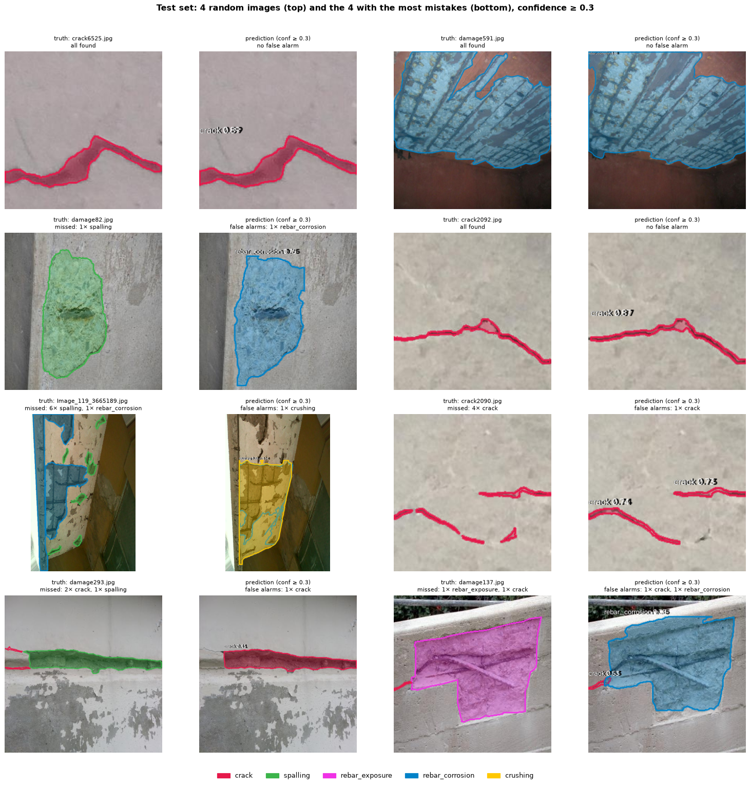
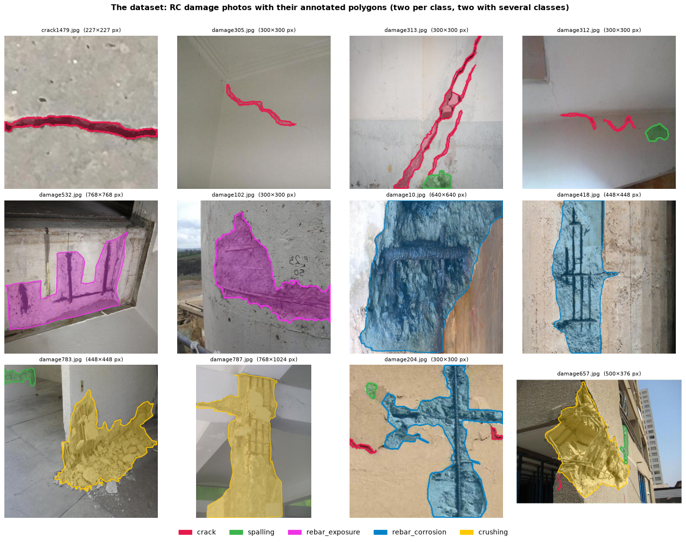
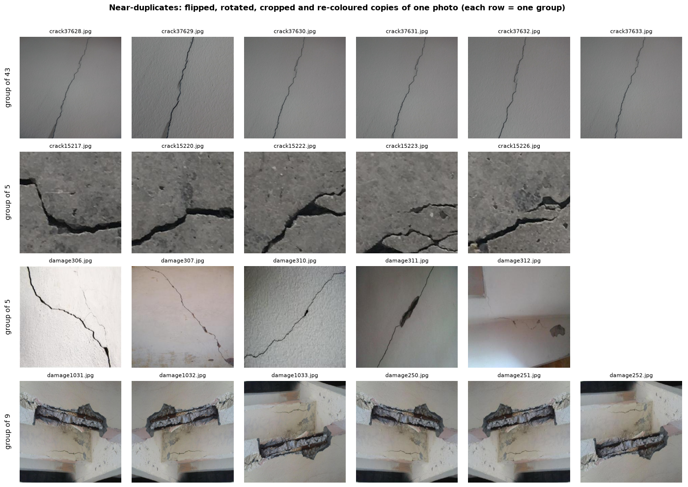
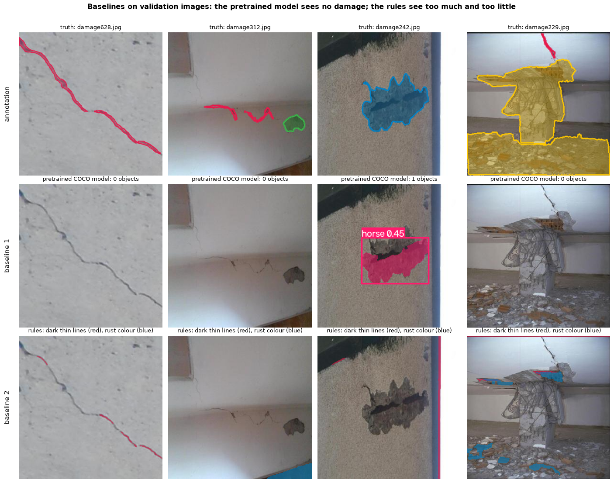
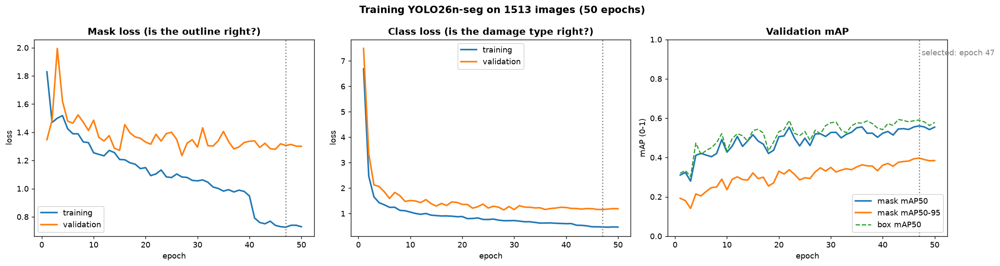
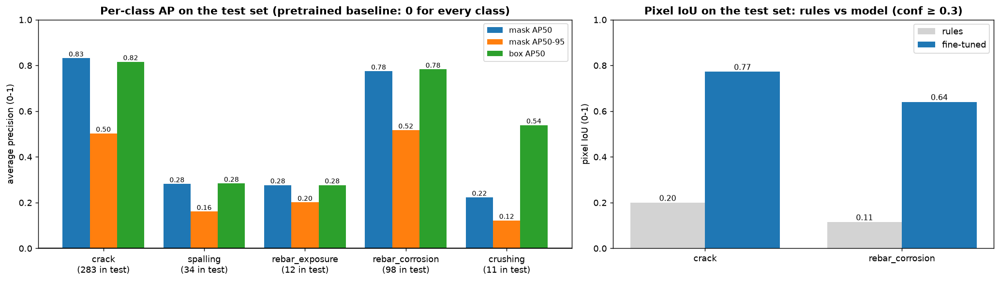
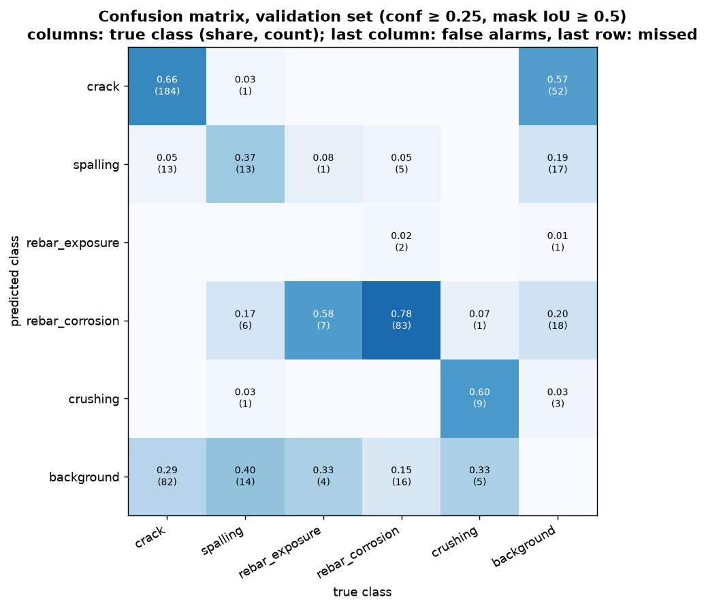
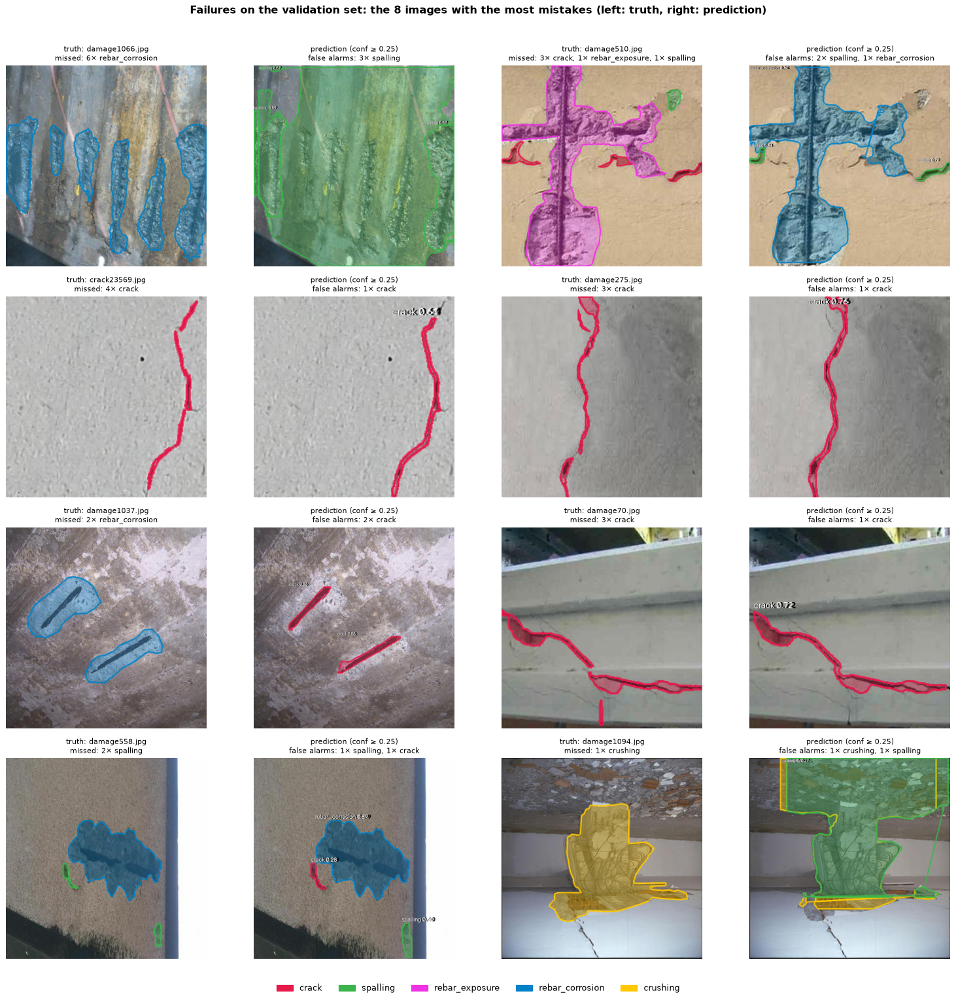
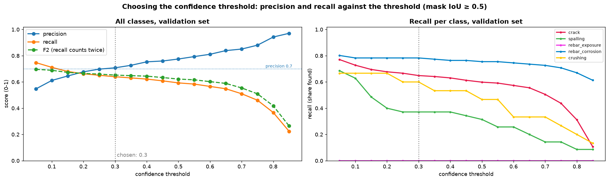
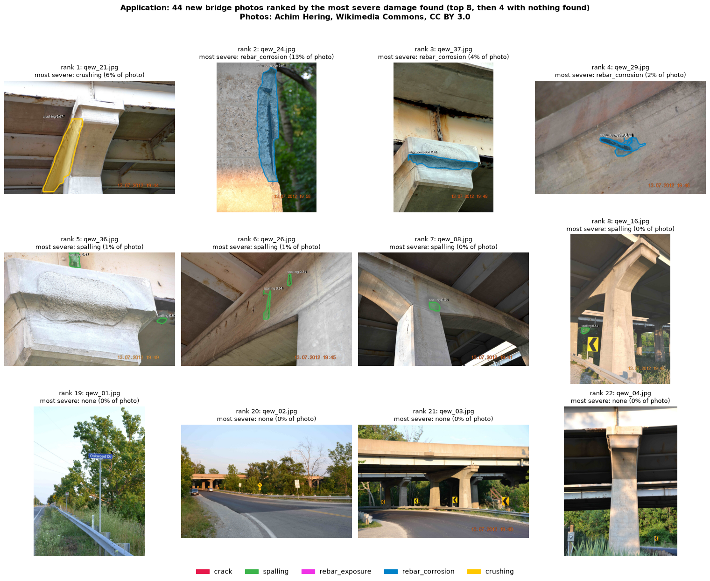

# Damage segmentation in reinforced concrete

**Team:** Group 4 – Luis, Fawad, Hetashri, Daria · **Course:** AI Methods I, Day 4 (IAAC MaAI 2026/27) · **Track:** B (fine-tuned YOLO26n-seg)
**Model on Hugging Face:** https://huggingface.co/iaac-maai/day4-group4-rc-damage-segmentation


*Test images, annotation (left) and prediction (right). Top: 4 random images. Bottom: the 4 with the most mistakes.*

## Use case

A facility manager or structural inspector has hundreds of photos of a building, parking garage or bridge and must decide which elements an engineer should look at first. The model outlines five types of damage on every photo (crack, spalling, rebar exposure, rebar corrosion, crushing), and the notebook turns the result into a **ranked inspection list**. **A missed exposed or corroded rebar, or crushed concrete, is the expensive mistake** (a structural problem stays unseen); a false alarm costs an engineer a few seconds to dismiss a photo. We therefore favour recall, but at least 70 % of the flagged outlines must be right, or the tool saves no time.

## Dataset

| | |
|---|---|
| **Name** | Reinforced concrete structure segmentation dataset 2119 (Wang, 2026) |
| **Source** | [Mendeley Data](https://data.mendeley.com/datasets/2vkm6k4cfg/1), DOI [10.17632/2vkm6k4cfg.1](https://doi.org/10.17632/2vkm6k4cfg.1) |
| **Content** | 2,119 photos of damaged RC structures, collected by the authors from public datasets, with one LabelMe polygon per damage |
| **Size** | 3,124 polygons: crack 1,833, spalling 282, rebar exposure 89, rebar corrosion 832, crushing 88 (the dataset page says 1,883 cracks; the annotation files contain 1,833). Every photo shows damage: there are no photos of intact concrete. |
| **Split** | train 1,513 / validation 303 / test 303 photos, by group of near-duplicates (see Approach) |
| **Licence** | CC BY 4.0 |

**New images for the application:** 46 photos of a damaged bridge in Niagara Falls by Achim Hering, [Wikimedia Commons](https://commons.wikimedia.org/wiki/File:Qew_bruecke_nf_beton_kaputt_01_von_46.jpg), CC BY 3.0 (2 were already in the dataset and were dropped).


*Examples with their annotated polygons.*

**What we see:** the photos are very different from each other: 227-px close-ups of one crack on plain concrete next to whole columns after an earthquake, up to 4,032 px wide. Cracks are 59 % of all polygons and very thin; exposed rebar and crushing usually cover a large part of the photo. The annotation style varies: one long crack is sometimes one polygon, sometimes four.

**Why it matters:** the classes are very unbalanced (crack 1,833 vs crushing 88), so we expected the model to be good at cracks and weak at the rare classes. The inconsistent annotation also means that some "mistakes" later are disagreements about how to cut a crack, not real misses.

## Repository structure

```
├── data/        # downloaded by the notebook (not committed)
├── figures/     # the 10 figures of the notebook
├── models/      # model card + its figures (model.pt is on Hugging Face)
├── notebook/
│   └── object_detection.ipynb
├── LICENSE
├── README.md
└── requirements.txt
```

## How to run

```bash
python -m venv .venv
source .venv/bin/activate        # Windows: .venv\Scripts\activate
pip install -r requirements.txt
```

Open `notebook/object_detection.ipynb` with the `.venv` kernel and run all cells. It downloads the dataset (160 MB) and the bridge photos. Training ran on a laptop GPU (Apple M4): 90 min for the main model, 32 min for the experiment. Without a GPU, set `TRAIN = False` to use our weights from Hugging Face.

⚠️ If the project folder is synced by iCloud/OneDrive/Dropbox, keep the training data out of the sync: iCloud deleted training images in the middle of our first runs.

## Approach

- **Duplicates first:** many photos are flipped, rotated or cropped copies of each other. We grouped copies (perceptual hash + ResNet18 features) and kept each group in one split: train 1,513 / val 303 / test 303.
- **Model:** YOLO26n-seg (3.1 M parameters, pretrained on COCO), 50 epochs, image size 640, batch 16, seed 42.
- **Baselines:** the pretrained YOLO without fine-tuning, and hand-written rules (dark thin lines = crack, rust colour = corrosion).
- **Experiment:** image size 640 vs 416 on validation.
- **Threshold:** the lowest confidence with at least 70 % precision on validation: **0.30**.


*Each row is one photo that appears several times in the dataset.*

**What we see:** the same photo appears mirrored, rotated, cropped and re-coloured. 77 % of the images belong to such a group, and only 736 independent groups remain out of 2,119 images.

**Why it matters:** the dataset authors (or their sources) augmented the photos *before* publishing them. With a random split, most test photos would have a copy in the training set, and the test would measure memory instead of skill. That is why we split by group.


*Top: annotation. Middle: the pretrained YOLO without fine-tuning. Bottom: hand-written rules.*

**What we see:** the pretrained model reports 85 objects on 76 of the 303 validation images, and all are wrong: corroded rebar becomes a *horse*, and across the validation set it reports *giraffes* (22 times), *kites* (15) and *teddy bears* (9). The rules mark fragments of real cracks, but also every dark edge and image border, and the rust rule marks soil, rubble and wood.

**Why:** the pretrained model only knows the 80 COCO classes (people, animals, objects). It has never seen damage, so it matches patterned textures to the closest thing it knows. The rules only look at colour and shape: a crack is not the only dark thin line on a building, and rust is not the only brown thing. Both baselines are weak, so the fine-tuned model has to be clearly better, not slightly.

## Results

| Test set (303 images) | mask mAP50 | mask mAP50-95 | pixel IoU crack | pixel IoU corrosion |
|---|---|---|---|---|
| Pretrained YOLO26n-seg | 0.00 | 0.00 | – | – |
| Rules (notebook 02 style) | – | – | 0.20 | 0.11 |
| **Fine-tuned YOLO26n-seg** | **0.478** | **0.301** | **0.77** | **0.64** |

At threshold 0.30 the model finds **69 %** of the damage (recall), and **75 %** of what it flags is real (precision).


*Training and validation loss per epoch (left, middle) and validation mAP (right).*

**What we see:** validation mask mAP50 rises fast from 0.31 (epoch 1) to 0.51 (epoch 20), then slowly to 0.56 at epoch 47, the weights we kept. The training mask loss keeps falling (1.83 → 0.73), but the validation mask loss stays at about 1.3 after epoch 20. The sudden drop at epoch 41 is the end of the mosaic augmentation.

**Why:** the fast start comes from transfer learning: the COCO features (edges, textures) already help. After that the model starts to memorise the training outlines (beginning overfitting): the dataset is small and full of near-copies, so there is little new to learn. More varied photos would help more than more epochs.


*Left: mask AP50, mask AP50-95 and box AP50 per class on the test set. Right: pixel IoU of the model vs the rules.*

**What we see:** two groups. Crack (0.83) and rebar corrosion (0.78) work well; spalling (0.28), exposed rebar (0.28) and crushing (0.22) do not. At our threshold of 0.30 the model finds 214 of 283 cracks and 74 of 98 corroded bars, but only 7 of 34 spalling areas, 2 of 12 exposed bars and 3 of 11 crushed areas. Against the rules, pixel IoU rises from 0.20 to 0.77 for cracks and from 0.11 to 0.64 for corrosion. The test score (0.48) is lower than validation (0.56).

**Why:** the good classes are the frequent ones (1,271 and 628 training polygons) and have a clear look: a dark line, orange rust. The weak classes have only 62–213 training polygons and fuzzy borders: spalling, crushing and exposed rebar all look like "broken grey concrete". Sadly these are the most severe types. The test score is lower than validation because every choice (model, threshold) was made on validation, and with 11–34 test polygons per rare class a few objects change the score a lot.


*Validation set, confidence ≥ 0.25. Each **column** is the true class, each **row** what the model said; the numbers are the share of the column (count in brackets). The diagonal is correct.*

- **Last row ("background") = damage the model missed:** 29 % of the cracks, 40 % of the spalling, a third of the exposed rebar and of the crushing.
- **Last column ("background") = false alarms:** outlines drawn where no damage is annotated. Of 91 false alarms, 52 (57 %) are cracks. Joints, shadows, edges and the dark lines of bars look like cracks to the model, and some are real cracks that the annotator cut into different pieces. The background/background cell is empty by definition, because "nothing predicted where there is nothing" is not counted.
- **Exposed rebar is never recognised as such:** 7 of 12 (58 %) are called rebar corrosion, none is right. The two classes differ only by rust, and the training set has 628 corrosion but only 65 exposure polygons, so the model picks the frequent class. Spalling is also often called corrosion (17 %), because corroded bars usually sit inside a spalled area.
- Rebar corrosion (78 %), cracks (66 %) and crushing (60 %) are mostly right.


*The 8 validation images with the most mistakes (left: annotation, right: prediction).*

**What we see and why:**
- **Cracks found but counted as wrong** (`crack23569`, `damage275`, `damage70`): the predicted crack lies right on the true one, but the annotator split it into 3–4 pieces and the model draws one line. The metric needs an overlap of at least 50 % per piece, so it counts several misses plus a false alarm. For thin, long objects a few pixels of offset halve the overlap, so the metric is harsh on cracks.
- **Many objects drawn as one** (`damage1066`): six corroded bars are annotated one by one, the model draws one large *spalling* area over all of them. It sees the damaged zone as a whole, and spalling usually surrounds corroded bars.
- **Ambiguous classes:** exposed rebar → corrosion (`damage510`), crushing → spalling (`damage1094`), and the dark lines of exposed bars taken for cracks (`damage1037`). The class borders are fuzzy for the annotators too, and the rare class always loses to the frequent one.


*Left: precision, recall and F2 against the confidence threshold. Right: recall per class (validation set).*

**What we see:** the lower the threshold, the more damage is found, but the more of the outlines are wrong. At 0.05, recall is highest, but 45 % of the outlines are false alarms (276). At **0.30** precision is 0.71 and recall 0.64, our choice. Corrosion recall stays at about 0.78 over a wide range; spalling recall drops from 0.69 to 0.37 between 0.05 and 0.25; exposed rebar has recall 0 at **every** threshold.

**Why:** the model is confident about corrosion (clear colour) and unsure about spalling (its predictions have low confidence, so they vanish as the threshold rises). For exposed rebar it never predicts the class at all, so no threshold can help; only more and better-labelled examples could.

**Test images (figure at the top of this README):** the random images are segmented well, including a corroded rebar mesh. The worst ones repeat the validation patterns: a spalled patch with a dark stain called *corrosion* (`damage82`, right outline, wrong class: the stain looks like rust), an exposed bar called corrosion (`damage137`), a peeling column called *crushing* (`Image_119_3665189`: both look like broken concrete), a spalled strip along a joint called a *crack* (`damage293`: long and thin like a crack), and a crack cut into pieces differently from the annotation (`crack2090`).


*44 new bridge photos (not in the dataset), ranked by the most severe damage found.*

**What we see:** ranks 2 and 4 (`qew_24`, `qew_29`: spalling with corroded bars) are right, the overview photos are correctly empty, and the cracks in `qew_41`, `qew_44` and `qew_45` are found and ranked "later". But rank 1 (`qew_21`) is a shadowed, intact pier edge called *crushing* (confidence 0.67), and `qew_37` is flagged as corrosion because of rust stains running down from the steel girder above. Worst, `qew_23`, a beam with clearly exposed, corroded bars, gets only *spalling* at 0.17 and lands in "no damage found". The one bridge photo that is in the training data (`qew_34`) gets corrosion at 0.82; the new ones only 0.2–0.7.

**Why:** these photos differ from the training data: evening light with hard shadows, steel girders and rust stains from steel, which the model has never seen. A dark shadow at a pier edge looks like the broken edge of a crushed column, and any orange-brown streak looks like corroded rebar. The high confidence on the photo it already knows shows how much the scores rely on familiar photos. **So the model can sort a photo series, but "no damage found" does not mean "no damage".**

**Experiment (validation):** 640 px reached mask mAP50 0.561, 416 px 0.537, but 416 px trained 2.8 × faster. We expected thin cracks to need the higher resolution, but crack AP50 was the same (0.76) at both sizes: many crack photos are only 227 px wide, so enlarging them to 640 adds no detail. The gain came from spalling (0.47 vs 0.34), with only 35 polygons, so partly noise. We kept 640 px.

**Overall:** the model learned the frequent, visually clear damage (cracks, rust) and not the rare, ambiguous and most severe one. Most of its errors come from the data (few examples, fuzzy class borders, inconsistent annotation, near-copies), not from the training settings, so better data would help more than a bigger model.

## Limitations

- **Data:** the photos come from unnamed public datasets, with mixed resolutions and cameras. Two of our "new" bridge photos were in the dataset.
- **No intact concrete:** every training photo shows damage, so the model has rarely seen healthy surfaces, joints, stains or formwork marks without damage around them. False alarms on healthy surfaces are probably underestimated by our test score (the bridge photos confirm this).
- **Annotation:** inconsistent (one crack vs several pieces; the line between rebar exposure and corrosion is a judgement call of the annotator).
- **Small numbers:** rare-class test scores rest on 11–34 polygons, and we trained one run per setting.
- **No scale:** damaged areas are shares of the photo, not of the element, so they cannot be turned into m² or crack widths.
- **Not for** structural safety decisions, crack-width measurement or clearing photos without a human look: a photo without detected damage is **not** proof that a structure is safe.

## AI usage disclosure

| | |
|---|---|
| **Tools** | Claude Code in VS Code |
| **How** | We worked through the project step by step together with the assistant: it wrote and ran the code and explained every step in detail (splits, duplicate detection, baselines, training, threshold choice). We made the key decisions (dataset, track, use case, which results to trust), checked the figures and failure cases ourselves and asked for corrections. |

**Lessons learned:** look at the data before trusting a score. This dataset was full of copies, and a random split would have measured memory. And keep training data out of cloud-synced folders.

## License

Code: [MIT](LICENSE). Model: AGPL-3.0 (fine-tuned from Ultralytics YOLO). Dataset: Wang, J. (2026), *Reinforced concrete structure segmentation dataset 2119*, Mendeley Data, V1, CC BY 4.0. Bridge photos © Achim Hering, CC BY 3.0.
